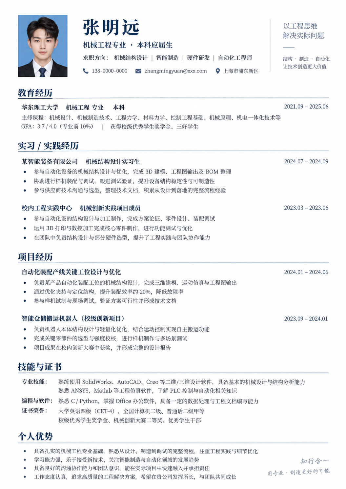
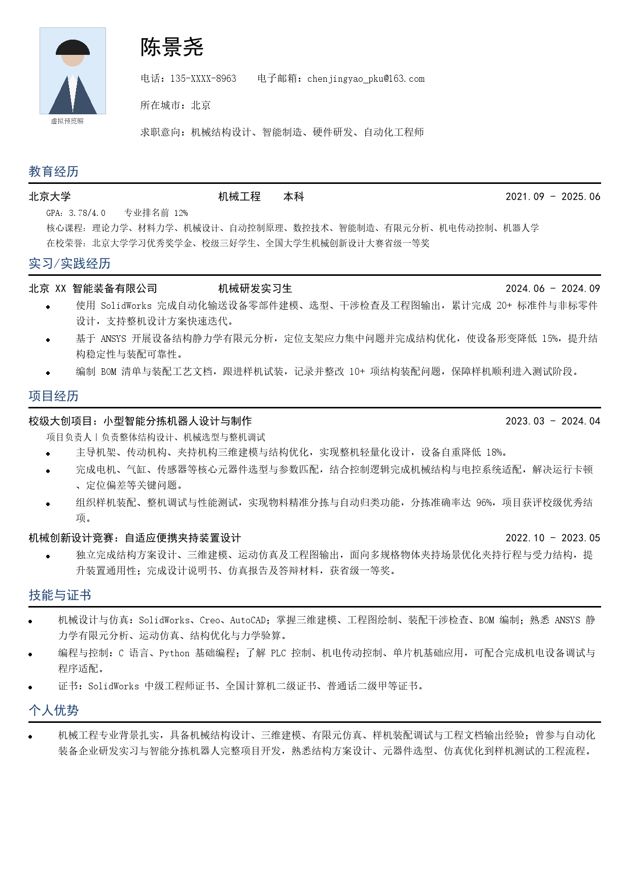

# resume-generator

一个用于生成、润色、定制和排版简历的 Codex Skill。支持中文、英文、双语简历，适用于求职简历、学术 CV、岗位定制和可编辑 Word 简历交付。

它不仅修改文字，还提供一套“先看视觉效果，再交付可编辑文档”的完整工作流。

## 核心工作流

当用户要求制作美观的 Word 简历时，`resume-generator` 按以下步骤工作：

1. **润色真实内容**：梳理目标岗位、教育经历、工作或实习经历、项目、科研、技能和荣誉，不编造经历或数据。
2. **用 ChatGPT 生图生成高审美风格稿**：探索版式、字体层级、颜色、留白和证件照位置。此时的图片只用于确定审美方向，细小文字可能是占位内容。
3. **用户挑选喜欢的版式方向**：可以调整颜色、信息密度、是否放照片、一页或两页等。
4. **用真实文本复刻为可编辑 Word**：按照选中的视觉方向，用真实文字、段落、表格和样式重建，不把整张预览图塞进 Word。
5. **渲染 Word 预览并确认**：检查分页、字体、日期对齐、文字裁切、重叠和照片比例。
6. **交付 `.docx`**：用户确认后提供可继续修改的 Word 文档；需要时也可同时提供 PDF 或 LaTeX 版本。

```text
原始经历 → 内容润色 → AI 风格稿 → 用户选版
        → 真实文本重建 → Word 渲染检查 → 可编辑 DOCX
```

## 风格稿示例

下面是 ChatGPT 生图生成的版式方向示例。它用于判断整体气质、层级、颜色和照片位置，不承担最终文字准确性。



选定方向后，再使用真实内容复刻成结构稳定、文字可选中、能够继续编辑的排版：



> 提示：AI 生成的姓名、学校、联系方式和正文可能是占位文字。最终简历必须以用户确认的真实资料为准。

## 一份完整简历通常包括什么

不同行业会有所增减，但一份结构完整的求职简历通常包含：

### 1. 个人信息

- 姓名
- 电话、邮箱、所在城市
- 求职方向或目标岗位
- 个人主页、GitHub、作品集或学术主页（如适用）
- 证件照（可选，应由用户决定）

### 2. 个人概述

用 2-4 行说明专业背景、经验方向和核心优势。应包含可验证的定位信息，避免“认真负责、学习能力强”等空泛表述。

### 3. 教育背景

- 学校、专业、学历
- 起止时间
- GPA、排名、核心课程
- 奖学金和重要荣誉

### 4. 工作或实习经历

每段经历建议写明：

- 公司或机构、部门、职位、时间
- 负责的任务和业务场景
- 使用的方法、工具或技术
- 可以验证的成果、规模或影响

推荐使用：`行动 + 方法/工具 + 场景 + 结果`。

### 5. 项目或科研经历

- 项目名称、角色、时间
- 研究或业务目标
- 个人承担的工作
- 数据、工具、方法和最终产出
- 论文、报告、奖项、系统或可量化结果

### 6. 专业技能

按岗位相关性分组，例如：

- 专业工具或软件
- 编程语言与数据工具
- 临床、实验或工程技能
- 语言能力
- 职业证书

技能应尽量能被前面的经历证明，不建议使用没有依据的熟练度进度条。

### 7. 可选模块

- 论文与专利
- 竞赛与荣誉
- 校园实践与志愿经历
- 作品集
- 专业证书
- 学术会议与公开演讲

## 预览阶段会生成什么

| 阶段 | 输出 | 用途 | 是否为最终内容 |
| --- | --- | --- | --- |
| 内容润色 | Markdown 或结构化文本 | 确认事实、顺序和表达 | 是 |
| AI 风格稿 | PNG 图片 | 选择视觉方向 | 否，文字可能是占位内容 |
| 可编辑版式预览 | Word/PDF 渲染 PNG | 检查真实文本与排版 | 是 |
| 最终交付 | `.docx` | 编辑、投递、打印 | 是 |
| 可选交付 | `.pdf` / `.tex` | 固定版式或 LaTeX 编辑 | 是 |

## 使用示例

### 润色现有简历

```text
用 resume-generator 润色这份简历，目标岗位是机械结构工程师。
保留真实经历，不要虚构指标。
```

### 先生成风格稿，再制作 Word

```text
用 resume-generator 把这份简历做成美观大方的 Word。
先用 ChatGPT 生图给我一张排版风格稿，等我确认后再制作可编辑 DOCX。
```

### 根据岗位描述定制

```text
根据下面的岗位 JD 调整我的简历，提取关键词并重排经历。
只使用我提供过的事实，最后生成一页 ATS 友好的版本。
```

### 制作中英文版本

```text
把这份中文简历改成自然、专业的英文简历。
不要逐字翻译，保持经历与数据一致。
```

## 设计与内容原则

- 不编造公司、学历、日期、项目、论文、证书或量化结果。
- 生图只负责视觉探索，最终正文必须是真实可编辑文本。
- 优先保证信息层级、阅读效率和岗位相关性。
- 中文求职简历通常优先使用 A4；应届生通常控制在 1 页，内容较多时可使用 2 页。
- 保持联系方式、标题、经历和技能可被 ATS 读取。
- 正式投递前必须检查拼写、日期、联系方式、证件照和文件名。

## 目录结构

```text
resume-generator/
├── SKILL.md
├── agents/
│   └── openai.yaml
├── examples/
│   ├── style-concept.png
│   └── editable-layout-preview.png
└── references/
    ├── academic-cv.md
    ├── ats-guidelines.md
    ├── bilingual-resume.md
    ├── chinese-resume.md
    ├── english-resume.md
    ├── project-bullets.md
    └── word-layout.md
```

## 安装

将仓库克隆到个人 Codex Skills 目录：

```bash
git clone https://github.com/From-zero-tohero/resume-generator.git ~/.codex/skills/resume-generator
```

重新启动或刷新 Codex 后，即可在对话中调用：

```text
用 resume-generator 帮我优化这份简历。
```
